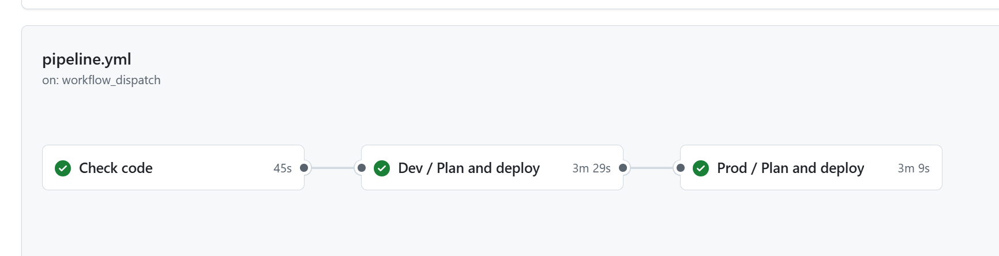
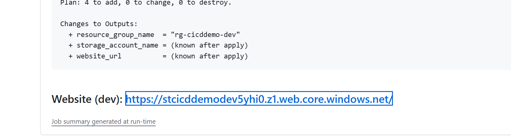
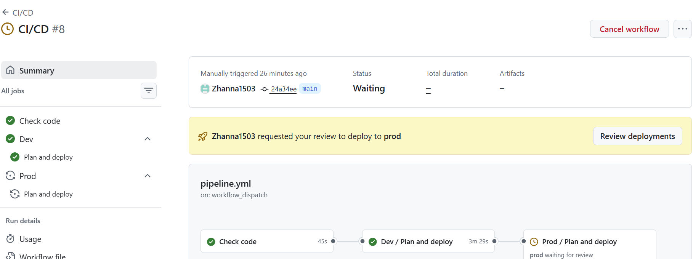
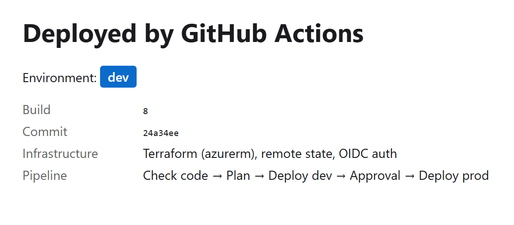
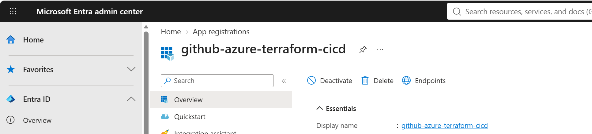
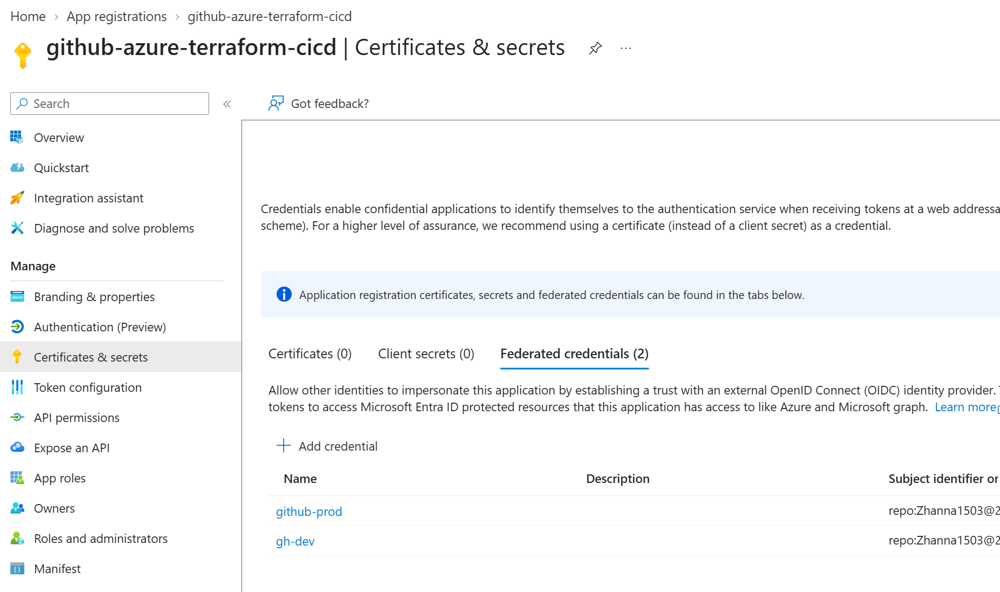

# Azure Terraform CI/CD – Portfolio Project

[](https://github.com/Zhanna1503/azure-terraform-cicd/actions/workflows/pipeline.yml)

A small but production-style CI/CD setup: **Terraform** builds a static website on Azure, and a
**GitHub Actions** pipeline checks, previews and deploys it to `dev` and `prod`, with a
**manual approval** before production. Runs at **€0**.

## Screenshots

**Successful run: check code → dev → prod**



**Terraform plan and website link in the run summary**



**Dev is deployed, prod waits for approval**



**The deployed website shows environment, build number and commit**



**Passwordless login: the app registration in Microsoft Entra ID that the pipeline uses**



**No client secret, only federated credentials: Azure trusts GitHub's short-lived tokens for this repository and environment**



## How it works

```
Pull request to main ─► Check code ─► Preview dev                          (nothing changes in Azure)

Push to main ────────► Check code ─► Deploy dev ─► [your approval] ─► Deploy prod
```

- **Check code:** `terraform fmt` (formatting), `terraform validate` (syntax), Checkov (security scan)
- **Plan:** Terraform compares the code with what exists in Azure and shows what it would change.
  You find the plan on the run's summary page.
- **Apply:** Terraform creates or updates the resources, then the website is uploaded.
- **Approval:** the GitHub environment `prod` requires a reviewer, so the run pauses until you approve.
- Changes to documentation only (`*.md`, `docs/`) don't trigger a deployment.

## What this project demonstrates

| Practice | Where |
|---|---|
| Pipeline as code (YAML) | `.github/workflows/pipeline.yml` |
| Reusable template, one definition for all environments | `.github/workflows/deploy-environment.yml` |
| Infrastructure as Code with remote state | `infra/` |
| Passwordless login to Azure (OIDC / workload identity federation) | `azure/login` + `ARM_USE_OIDC` |
| Plan before apply, preview on pull requests | `deploy-environment.yml` |
| Approval gate on production | GitHub environment `prod` |
| Quality and security checks | `terraform fmt`, `terraform validate`, Checkov |
| Environment-specific settings | `infra/env/*.tfvars` |
| Reproducible runs | runner image pinned to `ubuntu-24.04` |

## Lessons learned

- **Choosing the CI tool by its constraints.** Free Microsoft-hosted pipelines in Azure DevOps
  require linking a pay-as-you-go subscription. GitHub Actions is free for public repositories,
  so the pipeline moved there and the project runs at €0.
- **GitHub's OIDC subject now contains IDs.** Repositories created after 15 July 2026 send
  `repo:<owner>@<owner-id>/<repo>@<repo-id>:environment:<env>` instead of
  `repo:<owner>/<repo>:environment:<env>`. The federated credential in Microsoft Entra ID has to
  contain the numeric owner and repository IDs too.
- **Entra compares the subject literally.** Login failed with
  `AADSTS700213: No matching federated identity record found`, although the portal showed exactly
  the right subject. Listing the stored values with
  `az ad app federated-credential list` revealed a trailing space after `dev`.
- **Check what the pipeline really sends before changing settings.** A temporary step that printed
  only the first characters of the client ID and tenant ID ruled out wrong secrets in one run,
  without exposing the full values.

## Repository layout

```
.github/workflows/
  pipeline.yml             entry point: when the pipeline runs and in which order
  deploy-environment.yml   template: plan + deploy for one environment
infra/                     Terraform: resource group + storage account with static website
  env/dev.tfvars           settings per environment
  env/prod.tfvars
website/index.html         the deployed page (shows environment, build number and commit)
docs/                      screenshots for this README
```

## Costs: €0

- GitHub Actions is free for public repositories.
- The Azure resources (tiny storage accounts) cost a few cents per month. That is covered by the
  credit of a Visual Studio subscription or the Azure free trial, and nothing is charged unless
  you upgrade to pay-as-you-go.

## Setup (about 30 minutes)

### 1. Pick an Azure subscription

Either one works, the pipeline doesn't care:

- a **Visual Studio subscription** with monthly Azure credit, or
- the **Azure free trial**: https://azure.microsoft.com/free (credit card only for identity
  verification; nothing is charged unless you upgrade).

In the Azure Portal, open **Subscriptions** and copy the **Subscription ID**.

### 2. Create a login for GitHub (app registration)

1. Azure Portal → **Microsoft Entra ID** → **App registrations** → **New registration**
2. Name: `github-azure-terraform-cicd` → **Register**
3. On the overview page, copy the **Application (client) ID** (not the Object ID) and the
   **Directory (tenant) ID**.

> If you get "You do not have permission", your organization blocks app registrations.
> Use the Azure free trial instead.

### 3. Let GitHub use this login without a password (federated credentials)

In the app registration → **Certificates & secrets** → **Federated credentials** → **Add credential**:

| Field | Value |
|---|---|
| Federated credential scenario | GitHub Actions deploying Azure resources |
| Organization | `Zhanna1503` |
| Organization ID | `206701031` |
| Repository | `azure-terraform-cicd` |
| Repository ID | `1423360238` |
| Entity type | Environment |
| GitHub environment name | `dev` |
| Name | `github-dev` |

Click **Add**, then add a second one with environment name `prod` and name `github-prod`.

- The IDs are on `https://api.github.com/repos/<owner>/<repo>`: the first `"id"` is the repository
  ID, the `"id"` inside `"owner"` is the organization ID. For a copy of this repository, use your
  own names and IDs.
- Type every value **without extra spaces** and check the generated **Subject identifier**, e.g.
  `repo:Zhanna1503@206701031/azure-terraform-cicd@1423360238:environment:dev`.

### 4. Give the login permission on the subscription

**Subscriptions** → your subscription → **Access control (IAM)** → **Add** → **Add role assignment**
→ tab **Privileged administrator roles** → **Contributor** → **Next** → **Select members** →
search `github-azure-terraform-cicd` → **Select** → **Review + assign**.

### 5. Store the IDs in GitHub

Repository → **Settings** → **Secrets and variables** → **Actions**

Tab **Secrets** → **New repository secret** (three times):

| Name | Value |
|---|---|
| `AZURE_CLIENT_ID` | Application (client) ID from step 2 |
| `AZURE_TENANT_ID` | Directory (tenant) ID from step 2 |
| `AZURE_SUBSCRIPTION_ID` | Subscription ID from step 1 |

Tab **Variables** → **New repository variable**:

| Name | Value |
|---|---|
| `TFSTATE_STORAGE_ACCOUNT` | a globally unique name, 3–24 lowercase letters and digits, e.g. `sttfstatezhanna4821` |

### 6. Create the environments

Repository → **Settings** → **Environments** → **New environment**:

- `dev` → **Configure environment** → nothing to set
- `prod` → tick **Required reviewers** → add yourself → **Save protection rules**

### 7. Run it

**Actions** tab → **CI/CD** → **Run workflow** (or push a change to `main`).

Watch the jobs turn green. When the run reaches **Prod**, click **Review deployments** → tick
`prod` → **Approve and deploy**. The website URL is on the run's summary page.

> Don't leave an approval waiting: if you don't want to deploy to prod, click
> **Review deployments** → **Reject**, so the next run isn't held up.

## Try it out

1. Create a branch, change the heading in `website/index.html` and open a pull request.
   The pipeline checks the code and shows a preview for dev.
2. Merge the pull request: dev is deployed, prod waits for your approval.
3. Open the website URL and check the environment, build number and commit.

## Troubleshooting

| Error | Fix |
|---|---|
| `Secret AZURE_... is missing` | Setup step 5 |
| `AADSTS700213: No matching federated identity record found` | The credential's subject must match the subject in the error exactly: owner and repository IDs, upper/lower case, no extra spaces. Show the stored values with `az ad app federated-credential list --id <client-id> -o json` (e.g. in Azure Cloud Shell). |
| `AADSTS700016: Application ... was not found` | `AZURE_CLIENT_ID` or `AZURE_TENANT_ID` is wrong (setup steps 2 and 5) |
| `AuthorizationFailed` | Setup step 4 is missing, or wait about 5 minutes after assigning the role |
| `The storage account named ... is already taken` | Pick another `TFSTATE_STORAGE_ACCOUNT` |

## Clean up

- Delete the resource groups `rg-cicddemo-dev`, `rg-cicddemo-prod` and `rg-tfstate`,
  and the app registration `github-azure-terraform-cicd`.
- Using a subscription you will lose access to? Clean up before the access ends.
- The Azure free trial simply stops after 30 days; nothing is charged.
- The code stays here, so everything can be rebuilt in any subscription in minutes.

## Ideas to extend

- Port the same pipeline to Azure DevOps (Azure Pipelines) and compare
- Fix the Checkov findings, then make the scan blocking
- Switch storage access from account keys to Microsoft Entra ID only
- Add a smoke test that checks the website after each deployment
- Nightly drift detection: a scheduled run of `terraform plan`
